# prettymaids

**Make [Mermaid](https://mermaid.js.org) diagrams look good.** Modern themes, SVG post-processing, a CLI and a live playground, built around stock Mermaid so every diagram type keeps working.

**[Try it live in the playground →](https://pravin.github.io/prettymaids/)** · **[Gallery: every diagram type, side by side →](https://pravin.github.io/prettymaids/gallery/)**

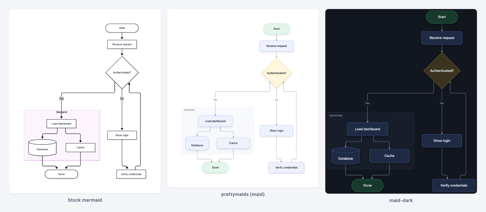

- **Modern defaults.** Hairline borders, soft shadows, chip-style edge labels, rounded boxes, Inter typography.
- **Three themes.** `maid` (light), `maid-dark`, and `maid-flat` (solid pastels, no shadow). One factory, so every setting works on every theme.
- **Tunable.** Type sizes, spacing, corner radius, connector style, colours, shadows, dot-grid canvas. Over 25 parameters, adjustable live in the playground.
- **Nine diagram types styled**: flowchart, sequence, class, state, ER, gantt, pie (as donuts), mindmap (XMind-style branches) and git graph.
- **Use it four ways**: a Mermaid theme config, a JS library, a CLI (SVG/PNG), and a browser playground.

**Tune it live.** Every look is a handful of parameters: radius, borders, colours, shadows, connectors, themes.

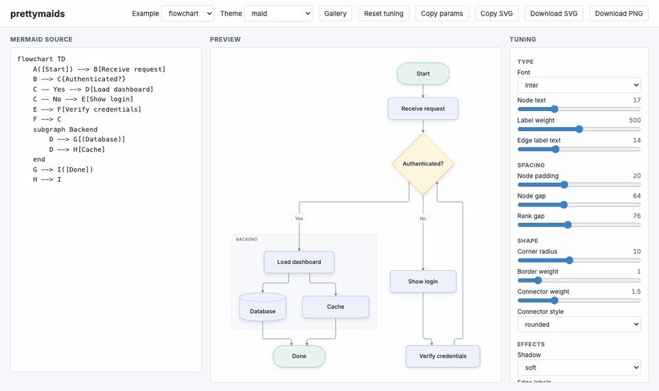

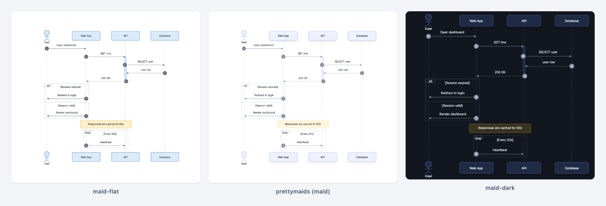

## Gallery

Stock Mermaid on the left, prettymaids on the right.

| | |
| --- | --- |
| **Sequence** | 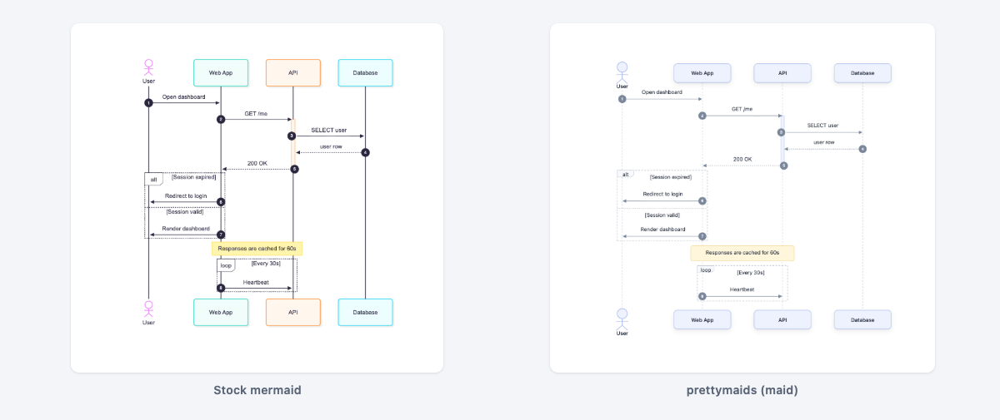 |
| **Class** | 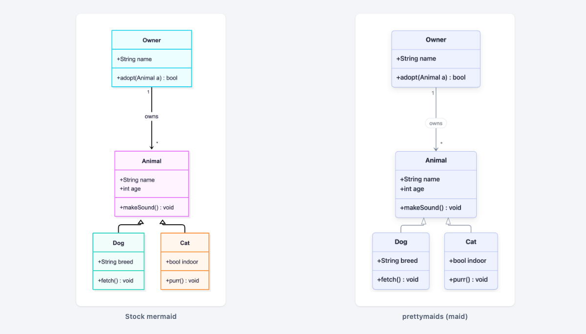 |
| **State** | 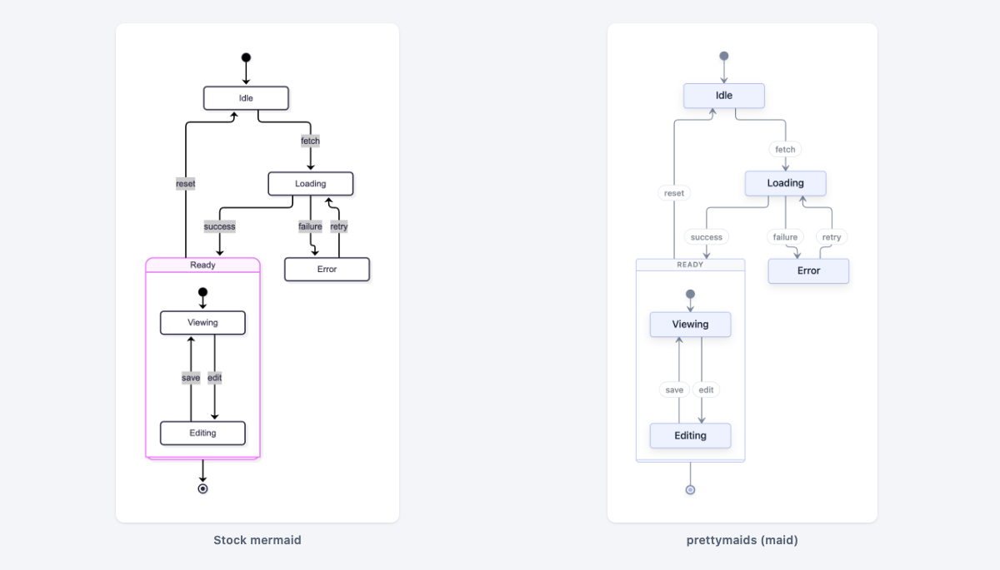 |
| **Entity-relationship** | 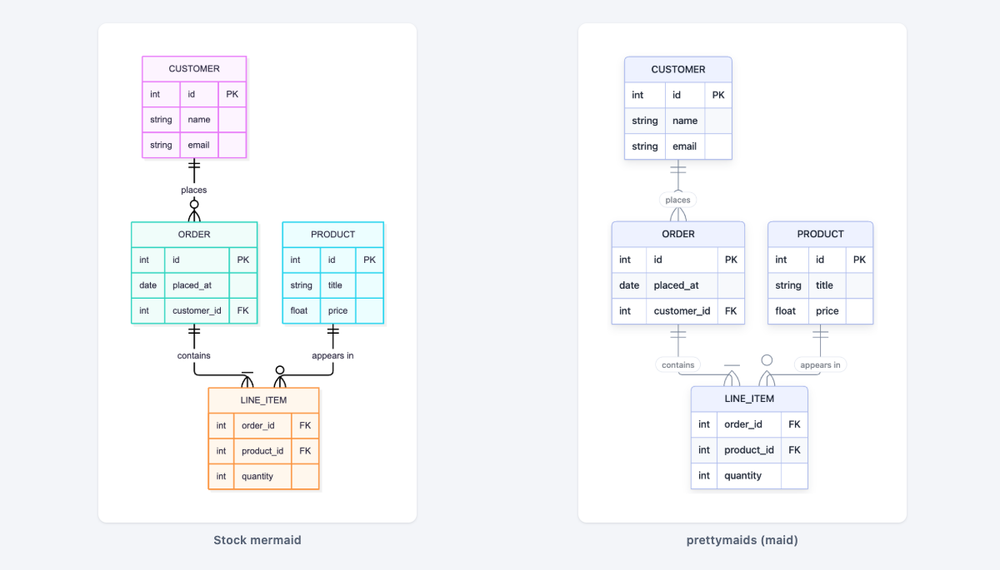 |
| **Gantt** | 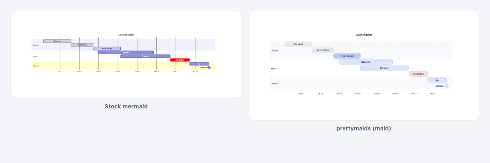 |
| **Pie** | 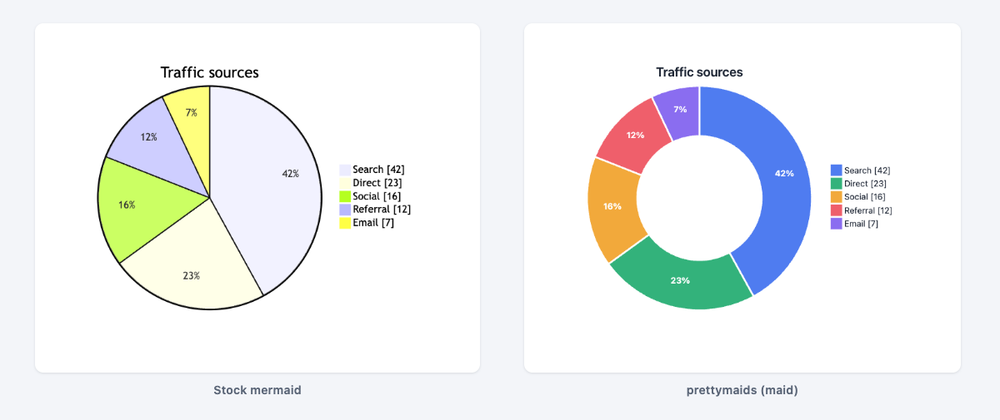 |
| **Mindmap** | 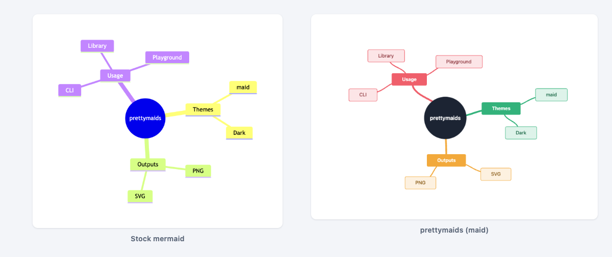 |
| **Git graph** | 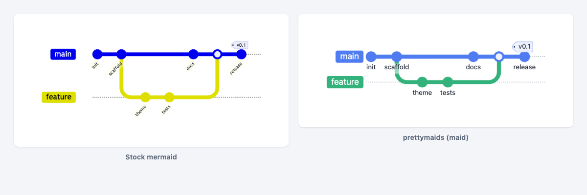 |

## Quick start

### 1. Playground

**[Open the hosted playground](https://pravin.github.io/prettymaids/)**: edit Mermaid, switch themes, drag the tuning sliders, export SVG or PNG. Your tuning is remembered in the browser, and "Copy params" gives you the JSON for the library or CLI.

To run it locally:

```sh
git clone https://github.com/pravin/prettymaids.git
cd prettymaids && npm install
npm run dev      # http://localhost:5173
```

### 2. CLI

```sh
npx prettymaids-cli diagram.mmd -o diagram.png               # PNG at 2x
npx prettymaids-cli diagram.mmd -t maid-dark -o diagram.svg  # dark SVG
cat diagram.mmd | npx prettymaids-cli -p fontSize=20 -p grid=dots > out.svg
npx prettymaids-cli --list-themes                            # every parameter, with ranges
```

Or `npm install -g prettymaids-cli` to get the `prettymaids` command.

| Option | |
| --- | --- |
| `-o, --output <file>` | `.svg` or `.png`. Default: SVG to stdout |
| `-t, --theme <name>` | `maid` (default), `maid-dark`, `maid-flat` |
| `-p, --param <key=value>` | Override a theme parameter. Repeatable; validated against the theme |
| `--bg <colour\|transparent>` | Background. PNG defaults to white |
| `--scale <n>` | PNG pixel scale (default 2) |

The CLI drives headless Chrome (a copy is downloaded on install, or set `CHROME_PATH` to use your own) because Mermaid needs a real browser to measure text. Text uses fonts installed on your machine, so install [Inter](https://rsms.me/inter/) to match the screenshots. Exit codes: `0` ok, `1` render or I/O failure (such as a Mermaid syntax error), `2` bad usage.

### 3. Library

```sh
npm install prettymaids mermaid
```

```js
import mermaid from 'mermaid';
import { render } from 'prettymaids';

const svg = await render('flowchart LR\n  A --> B --> C', {
  theme: 'maid-dark',
  params: { fontSize: 20, grid: 'dots' },
  mermaid,
});
```

`render()` needs a DOM (a browser or headless Chrome); for server-side use, the CLI is the easiest route.

### 4. Just a Mermaid theme

If you only want the colours, typography and connectors inside an existing Mermaid setup:

```js
import { config } from 'prettymaids';
mermaid.initialize(config('maid'));
```

This works with no other prettymaids code. It does not include what needs post-processing: shadows, donut pies, XMind-style mindmaps, rounded class/ER boxes, and the pill/diamond colouring. Use `render()` for the full look.

## Themes and parameters

| Theme | Look |
| --- | --- |
| `maid` | Hairline borders, soft shadow, chip edge labels, donut pies, organic mindmaps |
| `maid-dark` | The same on a dark background |
| `maid-flat` | Solid pastel fills, saturated 1.5px borders, no shadow, small corners |

Common parameters (run `prettymaids --list-themes` for all of them):

| Parameter | Values | |
| --- | --- | --- |
| `fontSize`, `edgeFontSize`, `fontWeight` | numbers | Type sizes and label weight |
| `font` | Inter, Open Sans, Helvetica, System, Mono | |
| `padding`, `nodeSpacing`, `rankSpacing` | numbers | Layout spacing |
| `radius`, `strokeWidth`, `lineWidth` | numbers | Corner radius, border and connector weight |
| `connector` | `rounded`, `elbow`, `straight`, `curved` | `rounded` is Mermaid's default layout; the others switch to the dagre layout |
| `shadow` | `none`, `soft`, `lifted` | |
| `edgeLabels` | `chip`, `plain` | |
| `pie` / `mindmap` | `donut`\|`pie` / `organic`\|`plain` | |
| `grid` | `none`, `dots` | Dot-grid canvas |
| `paintBackground`, `background` | `transparent`\|`solid`, colour | |
| `nodeFill`, `nodeStroke`, `decisionFill`, `terminalFill`, `lineColor`, `textColor`, ... | colours | |

## Diagram support

Styled: flowchart, sequence, class, state, ER, gantt, pie, mindmap, git graph.
Not styled yet (they still render, in Mermaid's defaults): journey, timeline, quadrant, XY chart, sankey, block, and others.

## How it works

prettymaids keeps Mermaid's parser and layout and changes how the result looks, in three layers: Mermaid `themeVariables` and `themeCSS`, per-diagram Mermaid config, and a DOM post-processor on the rendered SVG (shadows, rounded boxes, donut clipping, mindmap branches, dot grid). For flowcharts, `render()` renders twice: the first pass finds the pills and diamonds, the second sizes them consistently.

## Known limits

- Mermaid builds decision diamonds as squares, so they can't be made wide.
- The two-pass pill/diamond sizing applies to `render()` only, not the `config()` drop-in.
- `elbow` connectors use Mermaid's dagre layout and have slightly rougher arrowheads than the default `rounded`.
- Tested with Mermaid 12.3.

## Development

```sh
npm test                                   # vitest
npm run build -w packages/cli              # CLI + browser bundle
THEMES=maid,maid-dark,maid-flat node scripts/render-examples.mjs   # render examples/*.mmd (needs Google Chrome)
node scripts/docs-images.mjs               # rebuild the README images
node scripts/record-gif.mjs                # re-record docs/images/tuning.gif (needs Chrome + ffmpeg)
```

Layout: `packages/core` (themes, post-processor, `render()`), `packages/cli`, `apps/playground`, `examples`.

## License

[MIT](LICENSE). Dependencies keep their own licences (almost all MIT, ISC or Apache-2.0; Mermaid's layout engine elkjs is EPL-2.0 or GPL-3.0). No fonts are bundled; Inter and Open Sans are loaded by name or from Google Fonts in the playground.
